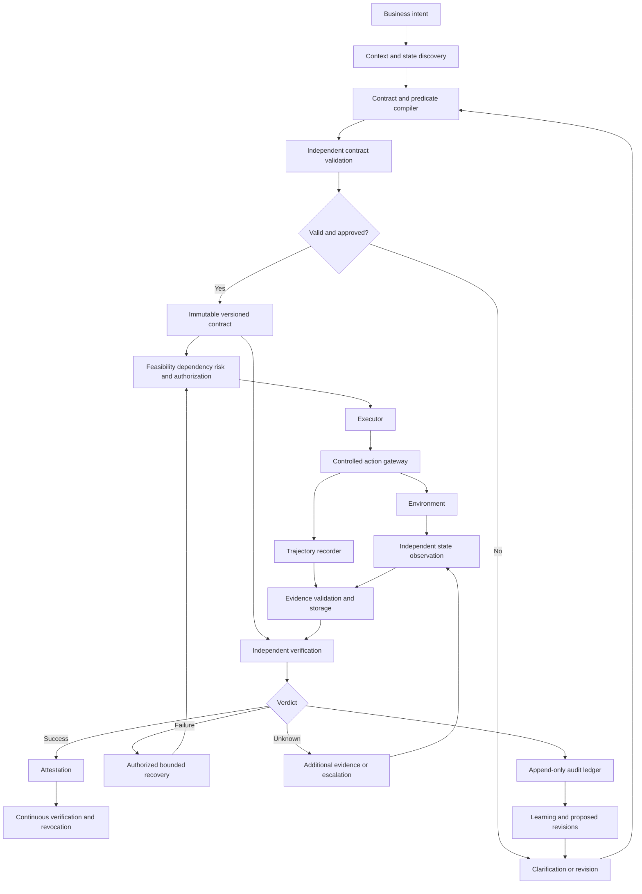

# Verification Control Plane v1.0 — Codex handoff

Status: architecture semantics frozen for implementation; not yet validated by experiments. Start with Phase 1. Do not expand scope until its acceptance gate passes.

## Mission and non-negotiable principle
Build a domain-independent, contract-driven assurance kernel for tasks executed by humans, agents or software. An executor's completion claim is never sufficient for success. Only independently collected, trustworthy evidence satisfying an approved immutable contract under declared trust assumptions can establish SUCCESS. Preserve separate execution status, verification verdict and attestation validity.

## Execution instructions
Inspect the repository, its AGENTS.md instructions, git status, baseline commit, tests and reusable capabilities first. Preserve unrelated changes. If starting from an empty workspace, initialize a minimal Python package. Reuse suitable existing code; avoid speculative scaffolding, unnecessary dependencies, nine microservices, dashboards or production deployments. Do not access real financial data, production infrastructure or credentials. Record actual commands, exit codes, test counts, failures and gaps. Do not claim work or tests not performed.

## Frozen architecture

Logical planes: intent/context; contract; control; execution; observation/evidence; verification; resolution; trust/assurance; learning. Separate execution, authorization and verification authority. An executor cannot modify approved contracts, authoritative evidence or verdicts. External uncontrolled actions limit assurance. Monitoring is not preventive enforcement.

## Domain model
Define typed identity, ownership, versioning, serialization, relationships, validation, failure semantics and tests for Intent, Context, Task, Contract, State, Action, Event, Trajectory, Predicate, Precondition, Postcondition, Invariant, Constraint, Policy, Dependency, Evidence, Claim, Verifier, Verdict, Attestation and Recovery. Use typed executable conditions, not free-form strings as authoritative predicates. Declare observation and trust boundaries.

## Canonical contract fields
- Identity/governance: contract ID, schema/version, tenant, owner, authorized approver, approval record, canonical hash and signature policy.
- Intent/context: objective, desired business outcome, value, acceptance rationale, environment, resource identities, assumptions, dependencies, trust boundaries, known limitations.
- State: baseline reference, desired state, preconditions, postconditions, required intermediate states, observation requirements.
- Correctness: nonempty explicit success criteria, failure criteria, invariants, constraints, prohibited side effects, acceptance thresholds and predicate composition.
- Execution: allowed executors/actions/resources, prohibited actions, idempotency, concurrency and side-effect classification.
- Budget/time: deadline, max duration/actions/attempts/cost/compute, stability window, evidence max age, attestation validity, termination conditions.
- Evidence: mandatory claim-to-evidence mappings, trusted sources, collection methods, coverage, provenance, independence and conflict policy.
- Verification: required methods/verifiers, assurance level, trust assumptions, missing evidence semantics, verdict conditions.
- Recovery: retries, rollback, compensation, escalation, authorization and independent recovery verification.

Contract compiler proposes; contract verifier validates structure, consistency, nonempty criteria, observability, evidence mappings, contradictions, feasibility and intent alignment. Require owner approval for unresolved semantic ambiguity; do not silently invent requirements. Approved contract versions immutable; canonical hash excludes mutable/signature envelope fields as explicitly specified. New semantic versions require approval. No vacuous success.

## Verification semantics
Use strong Kleene three-valued logic for AND, OR, NOT: TRUE established; FALSE demonstrated violation; UNKNOWN insufficient, conflicting or unsuitable evidence. SUCCESS iff all mandatory conditions (valid approved contract, applicable preconditions, authorization, success predicates, constraints, invariants, temporal conditions, sufficient evidence and assurance) established TRUE. FAILURE iff at least one mandatory violation established; otherwise UNKNOWN. Unsupported predicates, errors, missing data or evidence infrastructure faults never imply TRUE. Track verifier faults separately. Explicit failure criteria must be evaluated with correct polarity. Evidence sufficiency is a guard against success; missing evidence alone is not a demonstrated task violation. Define applicability, temporal bounds, and open-world semantics explicitly.

V0 intent alignment; V1 pre-execution; V2 runtime; V3 outcome; V4 continuous. Distinguish point-in-time, stability-window, always, eventual and deadline-bound conditions. Final state alone cannot prove a historical invariant. Unobserved intervals limit assurance. Historical verdict is immutable; expiration/revocation changes attestation validity, not past history.

## Evidence model
Each record: ID, claim/predicate, task/execution/contract version, source/collector identities, observation value/time/state version, coverage, collection method, freshness/validity, artifact reference, content hash, signature where required, trust policy, authenticity status. Validate authenticity, integrity, relevance, freshness, completeness, independence, coverage, conflicts, replay and cross-task/tenant isolation. A signed observation proves provenance under assumptions, not factual truth. Pin verifier and policy versions for replay.

## Runtime and interfaces
Durable lifecycle: draft, validation, approval pending, authorized, pre-verification, executing, observing, suspended, post-verification, collecting evidence, recovering, escalated, blocked, rejected, timed out, cancelled, completed. Specify event, actor, guards, side effects, persistence, failure and idempotency for every transition; reject undefined transitions. Separate lifecycle/verdict/attestation status.
Action gateway checks executor, contract version, task/execution, action scope, current state version, preconditions, remaining budget, invariants and idempotency. Use conditional/atomic operations where possible; document uncertainty after external effects. Bound execution, recovery and evidence collection. Recovery cannot erase historical violations.
Define typed ports with inputs, outputs, failure, authorization, concurrency and observability: IntentProvider, ContextResolver, ContractCompiler, ContractVerifier, ContractRepository, StateProvider, DependencyResolver, PolicyEngine, RiskEvaluator, Executor, ActionGateway, TrajectoryRecorder, EvidenceCollector, EvidenceVerifier, EvidenceRepository, PredicateEvaluator, InvariantMonitor, VerificationEngine, CompositionalVerifier, RecoveryController, AttestationEngine, AuditLedger.
Composition: parent/child contracts, sequential/parallel/conditional dependencies, shared resources, global invariants, budgets and compensation. Independently check parent outcome; never infer it solely from child success.

## Non-negotiable system invariants
INV-001 approved contracts cannot silently change.
INV-002 executors cannot issue their own successful verdicts.
INV-003 missing mandatory evidence cannot establish success.
INV-004 mandatory violations prevent success.
INV-005 unauthorized mutations rejected at controlled boundaries.
INV-006 verdict references exact contract version.
INV-007 verdict traceable to supporting evidence.
INV-008 execution, recovery and evidence collection bounded by budgets.
INV-009 stale evidence cannot establish current state except as explicitly allowed by temporal policy.
INV-010 child success alone cannot establish parent success.
INV-011 recovery cannot weaken approved correctness requirements.
INV-012 learning cannot rewrite approved contracts.
INV-013 concurrent changes controlled or detected before dependent actions wherever supported; limitations explicit.
INV-014 attestations support expiry/revocation.
INV-015 restarts cannot cause unauthorized duplicate effects; unsupported external exactly-once guarantees must not be claimed.
INV-016 tenant data, identities, permissions and evidence isolated.
INV-017 unobservable mandatory conditions remain UNKNOWN.
INV-018 verdict includes assurance level and trust assumptions.
Map each to component, enforcement, evidence, test and implementation status. Define trusted computing base and residual risks for tampering, evidence forgery/replay, compromised collectors, correlated errors, unauthorized mutations, races, duplicate effects, tenant leakage, budgets, metric gaming and attestation forgery.

## Implementation phases and boundaries
1. Verification kernel: typed contracts and validation, restricted typed predicates, tri-valued evaluation, state/evidence models, evidence validation, independent verification/verdict, durable audit, synthetic financial reconciliation reference scenario. Gate: false executor success cannot override trusted outcome evidence; missing evidence remains UNKNOWN.
2. Controlled execution: durable lifecycle, authorization, gateway, adapters, runtime invariants, budgets, idempotency and bounded recovery.
3. Composition and assurance: dependency graph, parent verification, global invariants, attestations, continuous verification and revocation.
4. Intelligence: natural-language compiler, context discovery, candidate invariants, verifier selection, trajectory analysis, improvement proposals. LLMs not sole authority for deterministic checks.
5. Organizational integration: finance, software engineering, infrastructure adapters, multi-tenant API and production hardening.
Only implement Phase 1 in this handoff. Mark future requirements as deferred, not passed. Do not automatically proceed to Phase 2.

## Technology choices (flexible)
Prefer minimal Python, typed schemas (Pydantic/JSON Schema if suitable), restricted deterministic expression evaluation, SQLite durable storage, pytest and property tests. Evaluate CEL, Z3, TLA+/TLC, OPA, Temporal, PostgreSQL, OpenTelemetry, LangGraph/MCP and in-toto/Sigstore only when concrete requirements demand them. Keep kernel independent of orchestration/cloud/LLM frameworks. No unnecessary network calls.

## Phase 1 reference domain and acceptance gate
Synthetic financial reconciliation: source completeness, unique IDs, no duplicates, amount conservation (integer minor units/explicit currency), matching correctness, unmatched classification, destination correctness, authorization and audit reproducibility. Use independent ground truth and collectors reading authoritative fixture state, not executor output. Compare executor-reported completion with verifier outcomes.
Golden cases: correct execution => SUCCESS; false success with incorrect state => FAILURE; mandatory evidence missing => UNKNOWN; partial execution => FAILURE if demonstrated, otherwise UNKNOWN; contradictory or empty contracts rejected; tampering rejected; fabricated evidence rejected; stale evidence rejected/recollected; conflicting evidence resolved or UNKNOWN; verifier errors never SUCCESS; mutation of verdict logic detected by independent tests. Additional later-phase cases: unauthorized actions, runtime invariant violation, budget exhaustion, crash/idempotency, concurrency, child success/global failure, drift revocation, unapproved revisions. Test independent oracle, property cases, adversarial fixtures, deterministic replay and feasible mutation tests. Report coverage and untested cases. Measure false success, false failure, unknown rate, invariant detection, evidence coverage, verification latency and cost (if measurable); report denominators and distinguish synthetic results from real enterprise impact.

## Required artifacts
ARCHITECTURE.md, ARCHITECTURAL_DECISIONS.md, FORMAL_SEMANTICS.md, DOMAIN_MODEL.md, CONTRACT_SCHEMA.json, STATE_MACHINE.md, INTERFACE_SPECIFICATION.md, TRUST_MODEL.md, SYSTEM_INVARIANTS.md, REQUIREMENTS_TRACEABILITY.md, ACCEPTANCE_TEST_SPECIFICATION.md, IMPLEMENTATION_PLAN.md. Keep concise and concrete; reuse equivalent existing files rather than duplicating. Then deliver executable Phase 1 code and tests, reproducible run instructions and a final evidence report. No placeholder implementation masquerading as complete functionality.

## Change control and definition of done
Architecture changes require concrete deficiency, reproducible failing scenario, impacted invariants, alternatives, compatibility assessment, updated acceptance tests and owner approval before semantic change. Implementation details flexible. Phase 1 is done only when its traceability, independent acceptance tests, deterministic replay and synthetic benchmark are reproducible with explicit trust assumptions and deferred scope. Return baseline commit, files changed, commands/results, evidence paths, requirement statuses, limitations and recommended next decision. If blocked, preserve work and report exact blocker; never mark unsupported claims as verified.
